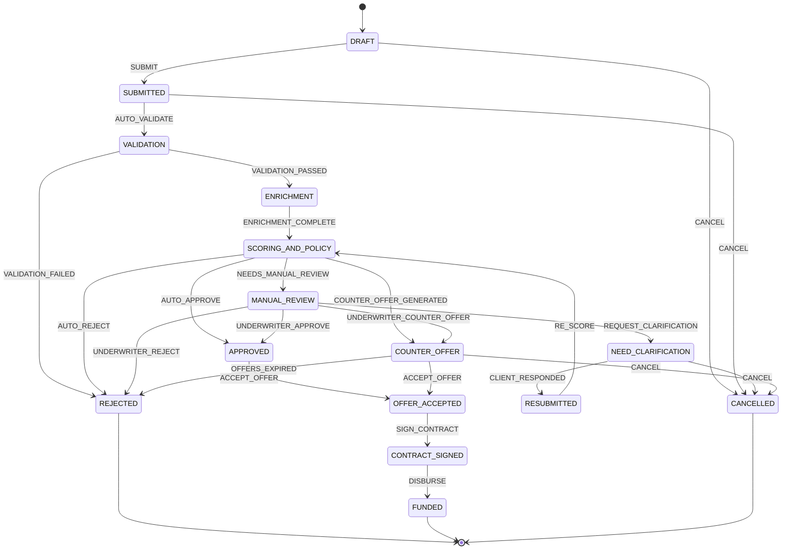

# MASTER_SPEC.md — Умный кредитный кабинет предпринимателя

> **Единственный источник истины для Flash-модели-строителя.**
> Каждый раздел — прямое указание к действию. Если описано — ОБЯЗАТЕЛЬНО к реализации.

---

## 1. Структура монорепозитория

```
alfahack/
├── docker-compose.yml
├── .env.example                # POSTGRES_DSN, OLLAMA_BASE_URL, APP_SECRET_KEY
├── MASTER_SPEC.md
│
├── backend/
│   ├── Dockerfile              # python:3.12-slim, pip install -r requirements.txt
│   ├── requirements.txt        # fastapi uvicorn[standard] pydantic-settings sqlalchemy[asyncio]
│   │                           # aiosqlite httpx python-multipart ollama
│   ├── main.py                 # FastAPI app factory, CORS *, lifespan (seed_db)
│   ├── config.py               # pydantic_settings.BaseSettings, все env
│   ├── database.py             # AsyncEngine + async_sessionmaker (SQLite default,
│   │                           #   POSTGRES_DSN переключает на PostgreSQL)
│   ├── models/
│   │   ├── __init__.py         # re-export Base и всех моделей
│   │   ├── base.py             # DeclarativeBase, uuid PK mixin, TimestampMixin
│   │   ├── company.py          # Company
│   │   ├── user.py             # User (role OWNER|ACCOUNTANT|UNDERWRITER)
│   │   ├── application.py      # CreditApplication
│   │   ├── audit_log.py        # ApplicationAuditLog
│   │   ├── enrichment.py       # EnrichmentSnapshot
│   │   ├── document.py         # Document
│   │   ├── offer.py            # CreditOffer
│   │   ├── clarification.py    # ClarificationRequest
│   │   └── news_item.py        # GovSupportNewsItem
│   │
│   ├── core_conveyor.py        # ★ АРТЕФАКТ 2 (уже написан, не менять!)
│   │
│   ├── routers/
│   │   ├── __init__.py
│   │   ├── applications.py     # CRUD заявок + переходы
│   │   ├── enrichment.py       # Триггер обогащения
│   │   ├── scoring.py          # Триггер скоринга
│   │   ├── decision.py         # Триггер решения, офферы
│   │   ├── documents.py        # Upload/download
│   │   ├── clarifications.py   # CRUD уточнений
│   │   ├── users.py            # Регистрация/вход/переключение роли
│   │   ├── presets.py          # God-Bar: активация пресетов
│   │   ├── ai_advisor.py       # Чат с AI-советником
│   │   └── news.py             # Лента господдержки
│   │
│   ├── services/
│   │   ├── __init__.py
│   │   ├── conveyor_service.py # Оркестратор advance_application()
│   │   ├── enrichment_service.py
│   │   ├── scoring_service.py
│   │   ├── decision_service.py
│   │   ├── ai_service.py       # Ollama + deterministic fallback
│   │   └── news_service.py
│   │
│   ├── enrichment_mocks/
│   │   ├── __init__.py
│   │   ├── fns_mock.py         # ФНС: блокировки, разрывы, численность
│   │   ├── egrul_mock.py       # ЕГРЮЛ/ЕГРИП: дата рег., уст. капитал, ОКВЭД, ликвидация
│   │   ├── bki_mock.py         # БКИ: кред. история, просрочки 0/30/60/90+
│   │   ├── alfa_accounts_mock.py # Обороты: помесячно 12 мес, контрагенты, налог. платежи
│   │   └── gov_support_mock.py # Программы господдержки
│   │
│   └── tests/
│       ├── test_scoring.py
│       ├── test_decision.py
│       └── test_state_machine.py
│
├── frontend/
│   ├── Dockerfile              # node:20-alpine → npm ci && npm run build → nginx
│   ├── package.json            # react react-dom react-router-dom @tanstack/react-query
│   │                           # recharts lucide-react tailwindcss vite axios zustand
│   ├── vite.config.ts
│   ├── tailwind.config.ts
│   ├── index.html
│   └── src/
│       ├── main.tsx
│       ├── App.tsx             # Layout + ViewSwitcher (Client | Bank | Split)
│       ├── api/
│       │   ├── client.ts       # axios, baseURL /api/v1
│       │   └── hooks.ts        # useApplication, useScoring, useOffers, usePresets
│       ├── store/
│       │   └── appStore.ts     # zustand: currentView, selectedPreset, applicationId
│       ├── components/
│       │   ├── layout/
│       │   │   ├── Header.tsx          # Лого + ViewSwitcher + God-Bar
│       │   │   ├── Sidebar.tsx
│       │   │   └── SplitLayout.tsx     # Два фрейма: Client + Bank
│       │   ├── god-bar/
│       │   │   └── PresetSelector.tsx  # 5 кнопок-пресетов
│       │   ├── client/
│       │   │   ├── ApplicationForm.tsx     # ИНН→автоподтяжка, продукт, сумма, срок
│       │   │   ├── ApplicationStatus.tsx   # Stepper по состояниям
│       │   │   ├── OffersCarousel.tsx      # 3 карточки (COUNTER_OFFER)
│       │   │   ├── RejectionPlan.tsx       # План оздоровления 60 дней
│       │   │   ├── DocumentUpload.tsx      # Drag-n-drop
│       │   │   ├── ClarificationChat.tsx   # Инлайн-чат с андеррайтером
│       │   │   ├── ContractSign.tsx        # OTP-имитация подписания
│       │   │   ├── AiAdvisorWidget.tsx     # Плавающий виджет AI
│       │   │   ├── NewsFeed.tsx            # Господдержка по ОКВЭД
│       │   │   └── DelegateToAccountant.tsx
│       │   └── bank/
│       │       ├── UnderwriterDashboard.tsx # Очередь MANUAL_REVIEW
│       │       ├── ApplicationReview.tsx    # Карточка заявки
│       │       ├── ScoringDetails.tsx       # SHAP/Waterfall (Recharts)
│       │       ├── EnrichmentViewer.tsx     # Данные ЕГРЮЛ/ФНС/БКИ/Обороты
│       │       ├── ClarificationForm.tsx    # Запрос доп. документов
│       │       ├── DecisionOverride.tsx     # Ручное решение аналитика
│       │       └── AuditTimeline.tsx        # Хронология событий
│       ├── pages/
│       │   ├── ClientDashboard.tsx
│       │   ├── BankDashboard.tsx
│       │   └── SplitView.tsx
│       └── utils/
│           ├── formatCurrency.ts
│           └── stateLabels.ts  # state→русское название+цвет
│
└── docs/
    ├── c4_context.md
    ├── c4_container.md
    ├── state_machine.md
    ├── erd.md
    ├── openapi_snapshot.yaml
    └── test_scenarios.md
```

### docker-compose.yml

```yaml
version: "3.9"
services:
  backend:
    build: ./backend
    ports: ["8000:8000"]
    environment:
      - DATABASE_URL=sqlite+aiosqlite:///./data/app.db
      - OLLAMA_BASE_URL=http://ollama:11434
      - SEED_ON_STARTUP=true
    volumes:
      - ./backend:/app
      - db-data:/app/data
    depends_on: [ollama]

  frontend:
    build: ./frontend
    ports: ["3000:80"]
    depends_on: [backend]

  ollama:
    image: ollama/ollama:latest
    ports: ["11434:11434"]
    volumes: [ollama-data:/root/.ollama]

volumes:
  db-data:
  ollama-data:
```

---

## 2. Граф состояний заявки (FSM)

### 2.1 Состояния

| State                 | Описание                                           | UI-цвет     |
|-----------------------|----------------------------------------------------|-------------|
| `DRAFT`               | Черновик                                           | `gray-400`  |
| `SUBMITTED`           | Отправлена                                         | `blue-500`  |
| `VALIDATION`          | Автовалидация полей                                | `blue-600`  |
| `ENRICHMENT`          | Обогащение ФНС/ЕГРЮЛ/БКИ/Обороты                  | `indigo-500`|
| `SCORING_AND_POLICY`  | Скоринг + кредитная политика                       | `purple-500`|
| `APPROVED`            | Автоодобрение                                      | `green-500` |
| `COUNTER_OFFER`       | 3 альтернативных оффера                            | `amber-500` |
| `MANUAL_REVIEW`       | В АРМ аналитика                                    | `orange-500`|
| `NEED_CLARIFICATION`  | Запрос доп. документов                             | `orange-400`|
| `RESUBMITTED`         | Клиент ответил → повторный скоринг                 | `blue-500`  |
| `REJECTED`            | Отказ + план оздоровления                          | `red-500`   |
| `OFFER_ACCEPTED`      | Клиент выбрал оффер                                | `green-400` |
| `CONTRACT_SIGNED`     | Договор подписан (OTP)                             | `green-600` |
| `FUNDED`              | Средства перечислены (терминальное)                 | `green-700` |
| `CANCELLED`           | Отменена клиентом                                  | `gray-500`  |

### 2.2 Таблица переходов

| # | From                 | To                   | Trigger                     | Actor               | Guard                                                        |
|---|----------------------|----------------------|-----------------------------|----------------------|--------------------------------------------------------------|
| 1 | DRAFT                | SUBMITTED            | SUBMIT                      | CLIENT_OWNER/ACCOUNTANT | Required-поля заполнены                                   |
| 2 | SUBMITTED            | VALIDATION           | AUTO_VALIDATE               | SYSTEM_CONVEYOR      | —                                                            |
| 3 | VALIDATION           | ENRICHMENT           | VALIDATION_PASSED           | SYSTEM_CONVEYOR      | ИНН валиден, сумма > 0                                      |
| 4 | VALIDATION           | REJECTED             | VALIDATION_FAILED           | SYSTEM_CONVEYOR      | ИНН невалиден / компания ликвидирована                       |
| 5 | ENRICHMENT           | SCORING_AND_POLICY   | ENRICHMENT_COMPLETE         | SYSTEM_CONVEYOR      | Все 4 источника вернули данные                               |
| 6 | SCORING_AND_POLICY   | APPROVED             | AUTO_APPROVE                | SYSTEM_CONVEYOR      | grade∈{A,B} AND requested≤max_unsecured AND нет стоп-факторов|
| 7 | SCORING_AND_POLICY   | COUNTER_OFFER        | COUNTER_OFFER_GENERATED     | SYSTEM_CONVEYOR      | grade∈{A,B,C} AND requested>max_unsecured AND нет стоп-факт.|
| 8 | SCORING_AND_POLICY   | MANUAL_REVIEW        | NEEDS_MANUAL_REVIEW         | SYSTEM_CONVEYOR      | grade==C AND soft_flags (сезонность, мало истории)           |
| 9 | SCORING_AND_POLICY   | REJECTED             | AUTO_REJECT                 | SYSTEM_CONVEYOR      | grade∈{D,E} OR стоп-фактор                                  |
|10 | MANUAL_REVIEW        | APPROVED             | UNDERWRITER_APPROVE         | BANK_UNDERWRITER     | —                                                            |
|11 | MANUAL_REVIEW        | REJECTED             | UNDERWRITER_REJECT          | BANK_UNDERWRITER     | —                                                            |
|12 | MANUAL_REVIEW        | NEED_CLARIFICATION   | REQUEST_CLARIFICATION       | BANK_UNDERWRITER     | —                                                            |
|13 | MANUAL_REVIEW        | COUNTER_OFFER        | UNDERWRITER_COUNTER_OFFER   | BANK_UNDERWRITER     | —                                                            |
|14 | NEED_CLARIFICATION   | RESUBMITTED          | CLIENT_RESPONDED            | CLIENT_OWNER/ACCOUNTANT | Загружен документ или дано пояснение                      |
|15 | RESUBMITTED          | SCORING_AND_POLICY   | RE_SCORE                    | SYSTEM_CONVEYOR      | —                                                            |
|16 | APPROVED             | OFFER_ACCEPTED       | ACCEPT_OFFER                | CLIENT_OWNER         | —                                                            |
|17 | COUNTER_OFFER        | OFFER_ACCEPTED       | ACCEPT_OFFER                | CLIENT_OWNER         | Выбран variant_index 1/2/3                                   |
|18 | OFFER_ACCEPTED       | CONTRACT_SIGNED      | SIGN_CONTRACT               | CLIENT_OWNER         | OTP подтвержден                                              |
|19 | CONTRACT_SIGNED      | FUNDED               | DISBURSE                    | SYSTEM_CONVEYOR      | —                                                            |
|20 | DRAFT                | CANCELLED            | CANCEL                      | CLIENT_OWNER         | —                                                            |
|21 | SUBMITTED            | CANCELLED            | CANCEL                      | CLIENT_OWNER         | —                                                            |
|22 | COUNTER_OFFER        | CANCELLED            | CANCEL                      | CLIENT_OWNER         | —                                                            |
|23 | NEED_CLARIFICATION   | CANCELLED            | CANCEL                      | CLIENT_OWNER         | —                                                            |
|24 | COUNTER_OFFER        | REJECTED             | OFFERS_EXPIRED              | SYSTEM_CONVEYOR      | >72ч без ответа                                              |

### 2.3 Mermaid State Diagram



### 2.4 Таблица `application_audit_log`

| Column          | Type           | Описание                                     |
|-----------------|----------------|----------------------------------------------|
| id              | UUID PK        |                                              |
| application_id  | UUID FK        | → credit_applications.id                     |
| from_state      | VARCHAR(30)?   | null для первой записи                       |
| to_state        | VARCHAR(30)    |                                              |
| trigger         | VARCHAR(40)    | Название триггера                            |
| actor_type      | ENUM           | CLIENT_OWNER/CLIENT_ACCOUNTANT/SYSTEM_CONVEYOR/BANK_UNDERWRITER |
| actor_id        | UUID?          | null для SYSTEM                              |
| details_json    | JSON           | Причина отказа, ID оффера и т.д.             |
| created_at      | TIMESTAMP      | UTC, server default now                      |

---

## 3. Двухступенчатая математика

### 3.1 Модуль 1: Risk Scoring Engine

**Вход:** данные обогащения. **Выход:** `risk_score(0..1000)`, `pd(0..1)`, `risk_grade(A-E)`, `stop_factors[]`, `factors_breakdown[]`.

**Базовый балл = 500. Дельты:**

| Группа    | Фактор                           | Макс.вес | Логика                                                                     |
|-----------|----------------------------------|----------|---------------------------------------------------------------------------|
| EGRUL     | Возраст бизнеса (лет)            | ±120     | <1:−120 · 1–2:−60 · 2–3:0 · 3–5:+60 · 5–10:+90 · 10+:+120               |
| EGRUL     | Уставный капитал (₽)             | ±40      | 10К(мин):−20 · 100К–1М:+10 · 1–10М:+25 · 10М+:+40                        |
| FNS       | Налоговые блокировки              | −200     | Есть → **СТОП-ФАКТОР** −200                                               |
| FNS       | Налоговые разрывы                 | −100     | 0→0 · 1→−40 · 2+→−100                                                     |
| FNS       | Численность сотрудников           | ±60      | 0:−60 · 1–5:0 · 6–20:+30 · 20+:+60                                       |
| BKI       | Чистая история (0 дней просрочки) | +100     | Есть кредиты, 0 дней:+100 · Нет кредитов:0                                |
| BKI       | Просрочка 30 дней                 | −60      | Есть→−60                                                                   |
| BKI       | Просрочка 60 дней                 | −120     | Есть→−120                                                                  |
| BKI       | Просрочка 90+ дней                | −200     | Есть → **СТОП-ФАКТОР** −200                                               |
| TURNOVER  | Среднемес. оборот                 | ±100     | <100К:−60 · 100К–500К:0 · 500К–2М:+40 · 2М–10М:+70 · 10М+:+100          |
| TURNOVER  | Тренд (3 мес vs пред.3)           | ±80      | Падение>30%:−80 · 10–30%:−40 · Стаб:0 · Рост10–30%:+40 · >30%:+80        |
| TURNOVER  | Уник. контрагенты                 | ±50      | <3:−30 · 3–10:0 · 10–30:+25 · 30+:+50                                    |
| TURNOVER  | Регулярность налог. платежей      | ±50      | Регулярно:+50 · Пропуски:−30                                              |

**Грейды после clamp(0, 1000):**

| risk_score | grade | PD%         |
|------------|-------|-------------|
| 800–1000   | A     | 0.5 – 2.0  |
| 650–799    | B     | 2.0 – 5.0  |
| 500–649    | C     | 5.0 – 12.0 |
| 350–499    | D     | 12.0 – 25.0|
| 0–349      | E     | 25.0 – 99.0|

**PD (линейная интерполяция):**
`PD = pd_high − (score − grade_low) / (grade_high − grade_low) × (pd_high − pd_low)`

**Стоп-факторы (auto-grade E, REJECTED):**
- Налоговая блокировка ФНС
- Просрочка 90+ в БКИ
- Ликвидация/банкротство (ЕГРЮЛ)
- Возраст бизнеса < 3 месяцев

---

### 3.2 Модуль 2: Decision & Counter-Offer Engine

**Продукты:**

| Продукт              | Код                    | Мин     | Макс       | Срок мес | Ставка A/B/C     | Залог от   |
|-----------------------|------------------------|---------|------------|----------|------------------|------------|
| Овердрафт             | OVERDRAFT              | 50К     | 3М         | 3–12     | 18% / 21% / 25%  | Нет        |
| Оборотный кредит      | WORKING_CAPITAL_LOAN   | 500К    | 30М        | 6–36     | 16% / 19% / 23%  | >5М        |
| ВКЛ                   | REVOLVING_LINE_VKL     | 300К    | 20М        | 12–36    | 17% / 20% / 24%  | >3М        |
| Инвестиционный        | INVESTMENT_LOAN        | 1М      | 50М        | 12–60    | 14% / 17% / 21%  | >3М        |

**Формула лимитов:**
```
net_monthly_income    = avg_monthly_revenue × net_margin (default 0.15)
max_monthly_payment   = max(0, net_monthly_income × 0.50 − existing_monthly_payments)
monthly_rate          = annual_rate / 12
annuity_factor        = monthly_rate / (1 − (1+monthly_rate)^(−term))
max_unsecured_limit   = max_monthly_payment / annuity_factor
max_secured_limit     = max_unsecured_limit × 2.0
```

**Decision Matrix:**
1. Стоп-факторы → **REJECTED** (+ план реабилитации)
2. grade∈{D,E} → **REJECTED** (+ план)
3. grade==C AND soft_flags → **MANUAL_REVIEW**
4. requested ≤ max_unsecured AND grade∈{A,B} → **APPROVED**
5. requested > max_unsecured → **COUNTER_OFFER** (3 варианта)

**Генерация 3 контр-офферов:**
```
Оффер 1: Сниженная сумма без залога
  amount=max_unsecured_limit, term=requested, rate=base, collateral=None

Оффер 2: Полная сумма с обеспечением
  amount=min(requested, max_secured_limit), rate=base−1%, collateral=Залог/МСП

Оффер 3: Альтернативный продукт
  WORKING_CAPITAL_LOAN → REVOLVING_LINE_VKL
  INVESTMENT_LOAN → WORKING_CAPITAL_LOAN с ×1.5 срок
  Иначе → тот же, срок×1.5, rate+1%
```

**План реабилитации (при REJECTED):**

| Причина                  | Действие                                             | Срок |
|--------------------------|------------------------------------------------------|------|
| Блокировка ФНС           | Погасить налоговую задолженность                      | 14д  |
| Просрочка 90+ БКИ        | Погасить просрочку, дождаться обновления БКИ          | 30д  |
| Возраст < 3 мес          | Накопить историю оборотов                             | 60д  |
| Низкие обороты           | Увеличить объём операций через р/с                    | 45д  |
| Ликвидация               | Отменить процедуру, получить выписку ЕГРЮЛ            | 30д  |

---

## 4. Синтетические профили (God-Bar)

### Пресет 1: ☕ ИП Кофеева — Автоодобрение

```json
{
  "preset_id": "coffee_shop_ip",
  "label": "☕ ИП Кофеева — Авто-одобрение овердрафта",
  "expected_outcome": "APPROVED",
  "company": {
    "inn": "771234567890", "ogrn": "321774600012345",
    "name": "ИП Кофеева Анна Михайловна", "legal_form": "IP",
    "okved_main": "56.10.1", "registration_date": "2019-03-15",
    "authorized_capital": null, "employee_count": 8, "is_active": true
  },
  "application": {
    "product_type": "OVERDRAFT", "requested_amount": 500000, "requested_term_months": 12
  },
  "enrichment": {
    "egrul": { "registration_date": "2019-03-15", "authorized_capital": null, "is_liquidating": false },
    "fns": { "tax_blocks": [], "tax_discrepancies": 0, "employee_count": 8 },
    "bki": {
      "active_loans": 1, "total_monthly_payment": 25000,
      "overdue_0": true, "overdue_30": false, "overdue_60": false, "overdue_90_plus": false
    },
    "alfa_accounts": {
      "monthly_revenue": [620000,580000,650000,700000,710000,680000,720000,750000,690000,730000,760000,800000],
      "avg_balance": 420000, "unique_counterparties": 35, "tax_payments_regular": true
    }
  }
}
```
**Ожидание:** score≈790, Grade A, PD≈2.2%, requested 500К ≤ max_unsecured → **APPROVED**.

### Пресет 2: 🏭 ООО ТехноСтрой — Counter-Offer

```json
{
  "preset_id": "manufacturing_ooo",
  "label": "🏭 ООО ТехноСтрой — Counter-Offer (3 альтернативы)",
  "expected_outcome": "COUNTER_OFFER",
  "company": {
    "inn": "7702123456", "ogrn": "1167746123456",
    "name": "ООО «ТехноСтрой Инновации»", "legal_form": "OOO",
    "okved_main": "25.11", "registration_date": "2016-06-20",
    "authorized_capital": 5000000, "employee_count": 42, "is_active": true
  },
  "application": {
    "product_type": "WORKING_CAPITAL_LOAN", "requested_amount": 20000000, "requested_term_months": 24
  },
  "enrichment": {
    "egrul": { "registration_date": "2016-06-20", "authorized_capital": 5000000, "is_liquidating": false },
    "fns": { "tax_blocks": [], "tax_discrepancies": 0, "employee_count": 42 },
    "bki": {
      "active_loans": 2, "total_monthly_payment": 180000,
      "overdue_0": true, "overdue_30": false, "overdue_60": false, "overdue_90_plus": false
    },
    "alfa_accounts": {
      "monthly_revenue": [4200000,4500000,4100000,4800000,5000000,4700000,5200000,5500000,5100000,5300000,5600000,5800000],
      "avg_balance": 2100000, "unique_counterparties": 28, "tax_payments_regular": true
    }
  }
}
```
**Ожидание:** score≈730, Grade B. net_monthly_income≈751К, max_payment≈195К, max_unsecured≈3.8М < 20М → **COUNTER_OFFER**.

### Пресет 3: 🚛 ООО ЛогиТранс — Manual Review

```json
{
  "preset_id": "logistics_seasonal",
  "label": "🚛 ООО ЛогиТранс — Ручной разбор + уточнение",
  "expected_outcome": "MANUAL_REVIEW",
  "company": {
    "inn": "5001234567", "ogrn": "1185001234567",
    "name": "ООО «ЛогиТранс»", "legal_form": "OOO",
    "okved_main": "49.41", "registration_date": "2024-03-15",
    "authorized_capital": 10000, "employee_count": 7, "is_active": true
  },
  "application": {
    "product_type": "REVOLVING_LINE_VKL", "requested_amount": 3000000, "requested_term_months": 24
  },
  "enrichment": {
    "egrul": { "registration_date": "2024-03-15", "authorized_capital": 10000, "is_liquidating": false },
    "fns": { "tax_blocks": [], "tax_discrepancies": 2, "employee_count": 7 },
    "bki": {
      "active_loans": 1, "total_monthly_payment": 85000,
      "overdue_0": true, "overdue_30": false, "overdue_60": false, "overdue_90_plus": false,
      "credit_history_months": 18
    },
    "alfa_accounts": {
      "monthly_revenue": [1800000,1600000,1200000,900000,700000,600000,800000,1000000,1300000,1500000,1700000,1900000],
      "avg_balance": 280000, "unique_counterparties": 8, "tax_payments_regular": false
    }
  }
}
```
**Ожидание:** score=600, Grade C, PD≈7.3%, soft flags (`seasonal_volatility`, `single_founder`, `few_counterparties`, `short_credit_history`) → **MANUAL_REVIEW** (уходит в АРМ андеррайтера).

### Пресет 4: ⛔ ООО ОптТрейд — Rejected + Реабилитация

```json
{
  "preset_id": "wholesale_rejected",
  "label": "⛔ ООО ОптТрейд — Отказ + План реабилитации",
  "expected_outcome": "REJECTED",
  "company": {
    "inn": "7725987654", "ogrn": "1207700987654",
    "name": "ООО «ОптТрейд»", "legal_form": "OOO",
    "okved_main": "46.73", "registration_date": "2020-11-05",
    "authorized_capital": 10000, "employee_count": 3, "is_active": true
  },
  "application": {
    "product_type": "WORKING_CAPITAL_LOAN", "requested_amount": 10000000, "requested_term_months": 18
  },
  "enrichment": {
    "egrul": { "registration_date": "2020-11-05", "authorized_capital": 10000, "is_liquidating": false },
    "fns": {
      "tax_blocks": [{"type": "ACCOUNT_BLOCK", "reason": "Непредставление декларации", "date": "2026-08-15"}],
      "tax_discrepancies": 3, "employee_count": 3
    },
    "bki": {
      "active_loans": 3, "total_monthly_payment": 320000,
      "overdue_0": false, "overdue_30": true, "overdue_60": true, "overdue_90_plus": true
    },
    "alfa_accounts": {
      "monthly_revenue": [800000,750000,600000,500000,450000,400000,350000,300000,280000,250000,200000,150000],
      "avg_balance": 45000, "unique_counterparties": 4, "tax_payments_regular": false
    }
  }
}
```
**Ожидание:** score≈80, Grade E, стоп-факторы: блокировка ФНС + просрочка 90+ → **REJECTED** + план 60 дней.

### Пресет 5: ✏️ Свой ввод

```json
{
  "preset_id": "custom_input",
  "label": "✏️ Свой ввод — заполните форму вручную",
  "expected_outcome": "DEPENDS_ON_INPUT",
  "company": null, "application": null, "enrichment": null
}
```
Пустая форма. ИНН не в моках → рандом Grade B–C.

---

## 5. Скрытые требования

### 5.1 Ролевая модель клиента

| Роль       | Код         | Права                                                                        |
|------------|-------------|-----------------------------------------------------------------------------|
| Собственник | OWNER       | Всё: создание, выбор продукта, принятие оффера, подпись, отмена, делегирование |
| Бухгалтер  | ACCOUNTANT  | Просмотр заявки, загрузка документов, ответ на уточнения. НЕ может принять оффер/подписать |

Делегирование: Owner → «Передать бухгалтеру» → создаётся User(ACCOUNTANT) → бухгалтер загружает документы → Owner принимает решение.
Для демо: при пресете создаются оба; переключение ролей — кнопка в Header без перелогина.

### 5.2 Виджет господдержки

Фильтр по `okved_prefix` (первые 2 цифры). При смене пресета — перестройка.
Кнопка «Применить к заявке» → `gov_program_id` в заявке.
`SUBSIDIZED_RATE` → ставка снижается до `max_rate_pct`.
`GUARANTEE_MSP` → `max_secured_limit × (1 + guarantee_pct)`.

**Моковые данные (≥8 новостей):**

| # | ОКВЭД    | Тип             | Заголовок                                                |
|---|----------|-----------------|----------------------------------------------------------|
| 1 | 56       | SUBSIDIZED_RATE | Льготный кредит для общепита до 13.5% (Программа 1764)   |
| 2 | 56       | GRANT           | Грант до 500К на открытие точки общепита                 |
| 3 | 25,28,29 | SUBSIDIZED_RATE | Льготное кредитование производств до 9%                  |
| 4 | 25,28,29 | GUARANTEE_MSP   | Гарантия Корпорации МСП до 70%                           |
| 5 | 49,52    | SUBSIDIZED_RATE | Субсидированная ставка для логистики 12%                 |
| 6 | 49,52    | TAX_BENEFIT     | Инвестиционный вычет на обновление автопарка              |
| 7 | 46       | GUARANTEE_MSP   | Зонтичная гарантия для оптовой торговли до 50%           |
| 8 | ALL      | SUBSIDIZED_RATE | Программа «Дальневосточная ипотека для бизнеса» до 10%   |

---

## 6. JSON-контракты API

**Base:** `/api/v1` · **Auth:** `X-User-Id` + `X-User-Role` · **Errors:** `{"detail":"..","error_code":".."}`

### 6.1 `GET /api/v1/presets` → `{ presets: [{ preset_id, label, expected_outcome, description }] }`

### 6.2 `POST /api/v1/presets/{preset_id}/activate`
→ 201: `{ company_id, owner_user_id, accountant_user_id, application_id, current_state }`

### 6.3 `POST /api/v1/applications`
← `{ company_id, product_type, requested_amount, requested_term_months, gov_program_id? }`
→ 201: `{ id, state:"DRAFT", created_at }`

### 6.4 `GET /api/v1/applications/{id}`
→ 200: Полная заявка со вложенными `scoring_result`, `decision_result`, `offers[]`, `rehabilitation_plan`, `enrichment_snapshots{}`, `audit_log[]`, `clarifications[]`, `documents[]`

### 6.5 `POST /api/v1/applications/{id}/transition`
← `{ trigger, payload: { selected_offer_variant?, otp_code? } }`
→ 200: `{ application_id, previous_state, new_state, trigger, audit_log_entry_id }`

### 6.6 `POST /api/v1/applications/{id}/enrich`
→ 200: `{ application_id, sources_fetched:["egrul","fns","bki","alfa_accounts"], enrichment_snapshot_id }`

### 6.7 `GET /api/v1/applications/{id}/scoring`
→ 200: `{ risk_score, pd, risk_grade, stop_factors[], factors_breakdown[{factor_name, group, raw_value, score_delta, max_weight, description}] }`

### 6.8 `GET /api/v1/applications/{id}/decision`
→ 200: `{ decision, max_monthly_payment, max_unsecured_limit, max_secured_limit, dti_ratio, offers[{variant_index, product_type, approved_amount, term_months, annual_rate_pct, monthly_payment, collateral_required, collateral_description, description}], rehabilitation_plan? }`

### 6.9 `POST /api/v1/applications/{id}/clarifications`
← `{ question_text, required_document_type }` (actor: UNDERWRITER)
→ 201: `{ clarification_id, status:"PENDING", application_new_state:"NEED_CLARIFICATION" }`

### 6.10 `POST /api/v1/clarifications/{id}/respond`
← `{ response_text, document_ids[] }` (actor: CLIENT)
→ 200: `{ clarification_id, status:"RESPONDED", application_new_state:"RESUBMITTED" }`

### 6.11 `POST /api/v1/applications/{id}/documents`
multipart/form-data: `file` + `doc_type` (PNL_STATEMENT|BALANCE_SHEET|OSV|TAX_RETURN|OTHER)
→ 201: `{ document_id, filename, doc_type, uploaded_by, url }`

### 6.12 `POST /api/v1/ai/chat`
← `{ application_id?, message }`
→ 200: `{ response, source:"ollama"|"fallback", suggestions[] }`

### 6.13 `GET /api/v1/news?okved_prefix=56`
→ 200: `{ items[{id, title, body, program_type, max_rate_pct?, guarantee_pct?, applicable_to_products[]}] }`

### 6.14 `POST /api/v1/applications/{id}/apply-program`
← `{ news_item_id }`
→ 200: `{ application_id, gov_program_id, rate_adjustment, message }`

### 6.15 `GET /api/v1/underwriter/queue`
→ 200: `{ applications[{id, company_name, inn, product_type, requested_amount, risk_grade, risk_score, state, soft_flags[]}] }`

### 6.16 `POST /api/v1/underwriter/applications/{id}/decide`
← `{ action:"APPROVE"|"REJECT"|"COUNTER_OFFER"|"REQUEST_CLARIFICATION", comment, override_offers? }`
→ 200: `{ application_id, new_state, audit_log_entry_id }`

---

## 7. Инструкция для Flash-строителя

**ПОРЯДОК:** 1) Скопировать `core_conveyor.py` без изменений → 2) models/ → 3) database.py+config.py → 4) enrichment_mocks/ → 5) services/ → 6) routers/ → 7) main.py → 8) tests/ → 9) frontend/ → 10) Docker → 11) E2E тест 5 пресетов.

**ПРАВИЛА:** НЕ менять формулы в core_conveyor.py. НЕ менять граф переходов. НЕ менять JSON-контракты. API ответы camelCase (Pydantic alias_generator). Модели БД snake_case.
