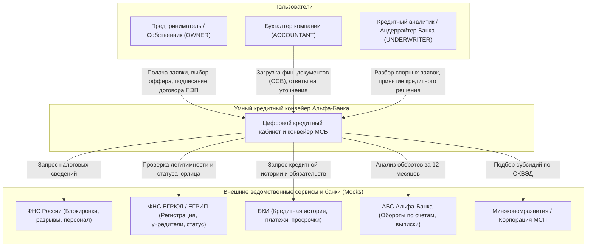
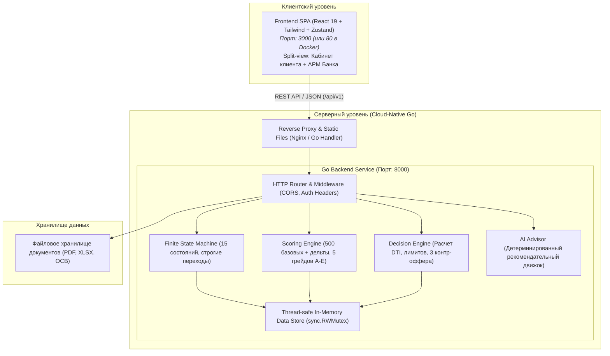

# Архитектура решения (C4 Model)

Архитектура «Умного кредитного кабинета предпринимателя» построена в соответствии с принципами **Cloud-Native**, автономности и микросервисного разделения ответственности.

---

## 1. Контекстная диаграмма (C4 System Context)

---

## 2. Диаграмма контейнеров (C4 Containers)

---

## 3. Компоненты бэкенда на Go

1. **`internal/conveyor/engine.go`**:
   - Двухступенчатая математика:
     - **Модуль 1 (Риск-скоринг):** расчет `risk_score` (0..1000), `pd` (вероятность дефолта 0..1), `risk_grade` (A, B, C, D, E), декомпозиция факторов (Waterfall/SHAP).
     - **Модуль 2 (Кредитное решение):** расчет чистого дохода бизнеса (`net_margin = 15%`), допустимой долговой нагрузки (`DTI <= 50%`), расчет лимитов через финансовый аннуитет, формирование матричного кредитного решения и 3 адаптивных контр-офферов.
2. **`internal/conveyor/fsm.go`**:
   - Валидированный конечный автомат (FSM) с защитой от недопустимых переходов (Guards), фиксацией актора действия и формированием неизменяемого аудит-следа (`audit_log`).
3. **`internal/store/store.go`**:
   - Высокопроизводительное in-memory хранилище состояния заявок, компаний, пользователей, документов и запросов уточнений с многопоточной защитой через `sync.RWMutex`.
4. **`internal/handlers/`**:
   - REST API контроллеры для жизненного цикла заявок, пресетов (God-Bar), АРМ андеррайтера, загрузки файлов и взаимодействия с AI-советником.
