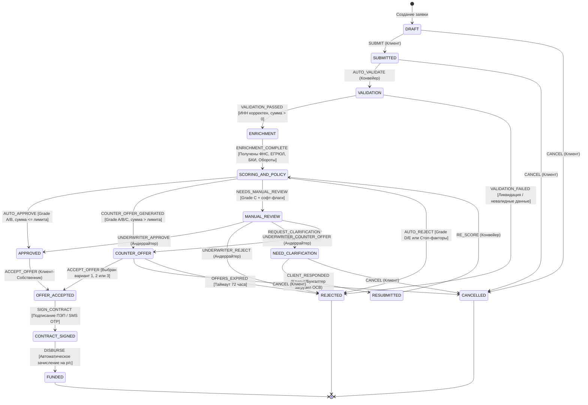

# Граф состояний кредитной заявки (FSM)

Цифровой кредитный конвейер Альфа-Банка управляется строгим конечным автоматом (Finite State Machine). Любое изменение статуса заявки сопровождается валидацией бизнес-правил (Guards), фиксацией инициатора (Actor) и записью в журнал аудита.

---

## 1. Диаграмма переходов состояний (Mermaid)

---

## 2. Справочник состояний

| Состояние | Наименование в UI | Описание |
|---|---|---|
| `DRAFT` | Черновик | Пользователь вводит параметры заявки или редактирует форму |
| `SUBMITTED` | Отправлена | Заявка передана на первичную обработку |
| `VALIDATION` | Проверка данных | Автоматическая проверка корректности ИНН, ОГРН и полей |
| `ENRICHMENT` | Обогащение данных | Сбор информации из внешних источников (ФНС, ЕГРЮЛ, БКИ, Обороты) |
| `SCORING_AND_POLICY` | Скоринг и политика | Расчет кредитного рейтинга и проверка лимитов риска |
| `APPROVED` | Одобрено | Автоматическое одобрение на запрошенных условиях |
| `COUNTER_OFFER` | Альтернативные офферы | Формирование 3 адаптивных предложений при превышении лимита |
| `MANUAL_REVIEW` | На рассмотрении аналитика | Заявка передана в АРМ андеррайтера (сезонные колебания, мало истории) |
| `NEED_CLARIFICATION` | Требуются документы | Банк запросил пояснения или оборотно-сальдовую ведомость (ОСВ) |
| `RESUBMITTED` | Ответ отправлен | Клиент предоставил документы, заявка готова к повторному скорингу |
| `REJECTED` | Отказ | Отказ с автоматической генерацией пошагового плана финансового оздоровления |
| `OFFER_ACCEPTED` | Оффер выбран | Клиент акцептовал конкретное кредитное предложение |
| `CONTRACT_SIGNED` | Договор подписан | Кредитный договор подписан ПЭП через подтверждение кодом из SMS |
| `FUNDED` | Средства зачислены | Денежные средства зачислены на расчётный счёт предпринимателя |
| `CANCELLED` | Отменена | Заявка отозвана по инициативе клиента |

---

## 3. Таблица переходов и Guard-условий

| # | Исходное состояние | Целевое состояние | Триггер | Актор | Guard-условия |
|---|---|---|---|---|---|
| 1 | `DRAFT` | `SUBMITTED` | `SUBMIT` | `CLIENT_OWNER` / `CLIENT_ACCOUNTANT` | Заполнены обязательные поля заявки |
| 2 | `SUBMITTED` | `VALIDATION` | `AUTO_VALIDATE` | `SYSTEM_CONVEYOR` | Автоматически |
| 3 | `VALIDATION` | `ENRICHMENT` | `VALIDATION_PASSED` | `SYSTEM_CONVEYOR` | Валидный ИНН, сумма > 0, нет признаков недействительности |
| 4 | `VALIDATION` | `REJECTED` | `VALIDATION_FAILED` | `SYSTEM_CONVEYOR` | Невалидный ИНН или компания в черном списке |
| 5 | `ENRICHMENT` | `SCORING_AND_POLICY` | `ENRICHMENT_COMPLETE` | `SYSTEM_CONVEYOR` | Получены данные всех 4 модулей |
| 6 | `SCORING_AND_POLICY` | `APPROVED` | `AUTO_APPROVE` | `SYSTEM_CONVEYOR` | Grade ∈ {A, B}, сумма ≤ max_unsecured, нет стоп-факторов |
| 7 | `SCORING_AND_POLICY` | `COUNTER_OFFER` | `COUNTER_OFFER_GENERATED` | `SYSTEM_CONVEYOR` | Grade ∈ {A, B, C}, сумма > max_unsecured |
| 8 | `SCORING_AND_POLICY` | `MANUAL_REVIEW` | `NEEDS_MANUAL_REVIEW` | `SYSTEM_CONVEYOR` | Grade = C + софт-флаги (сезонность, 1 учредитель) |
| 9 | `SCORING_AND_POLICY` | `REJECTED` | `AUTO_REJECT` | `SYSTEM_CONVEYOR` | Grade ∈ {D, E} или активный стоп-фактор |
| 10 | `MANUAL_REVIEW` | `APPROVED` | `UNDERWRITER_APPROVE` | `BANK_UNDERWRITER` | Положительное решение аналитика |
| 11 | `MANUAL_REVIEW` | `REJECTED` | `UNDERWRITER_REJECT` | `BANK_UNDERWRITER` | Отказ аналитика с указанием причины |
| 12 | `MANUAL_REVIEW` | `NEED_CLARIFICATION` | `REQUEST_CLARIFICATION` | `BANK_UNDERWRITER` | Сформирован запрос документов (ОСВ) |
| 13 | `MANUAL_REVIEW` | `COUNTER_OFFER` | `UNDERWRITER_COUNTER_OFFER` | `BANK_UNDERWRITER` | Корректировка параметров оффера |
| 14 | `NEED_CLARIFICATION` | `RESUBMITTED` | `CLIENT_RESPONDED` | `CLIENT_OWNER` / `CLIENT_ACCOUNTANT` | Загружен файл или дано текстовое пояснение |
| 15 | `RESUBMITTED` | `SCORING_AND_POLICY` | `RE_SCORE` | `SYSTEM_CONVEYOR` | Автоматический перерасчет с учетом новых данных |
| 16 | `APPROVED` | `OFFER_ACCEPTED` | `ACCEPT_OFFER` | `CLIENT_OWNER` | Акцепт основного оффера |
| 17 | `COUNTER_OFFER` | `OFFER_ACCEPTED` | `ACCEPT_OFFER` | `CLIENT_OWNER` | Выбран вариант 1, 2 или 3 |
| 18 | `OFFER_ACCEPTED` | `CONTRACT_SIGNED` | `SIGN_CONTRACT` | `CLIENT_OWNER` | Успешная проверка OTP-кода подтверждения |
| 19 | `CONTRACT_SIGNED` | `FUNDED` | `DISBURSE` | `SYSTEM_CONVEYOR` | Проводка зачисления в АБС |
| 20 | `*` | `CANCELLED` | `CANCEL` | `CLIENT_OWNER` | Доступно до момента подписания договора |
